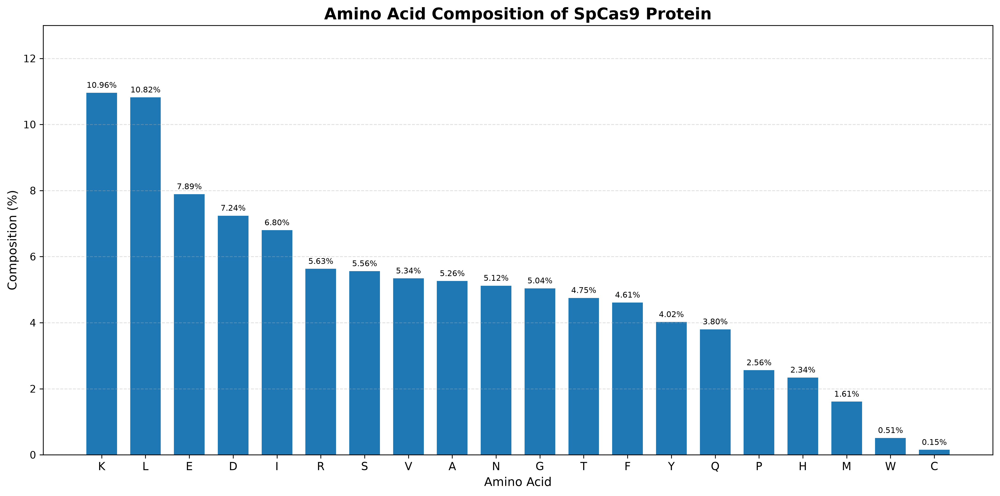
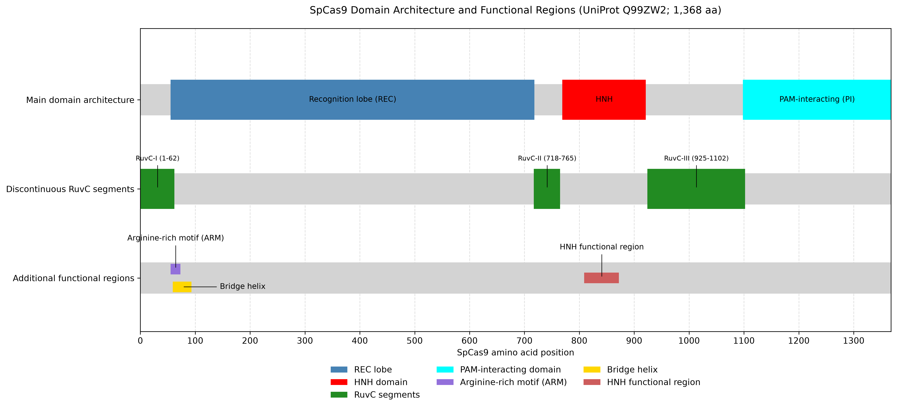
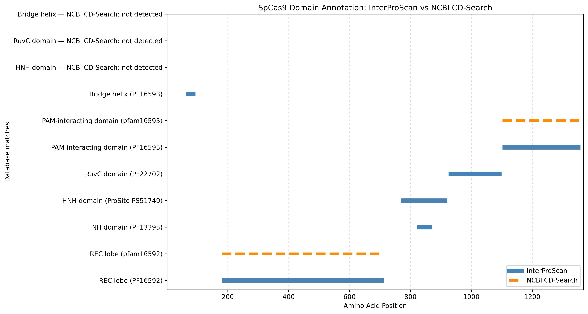
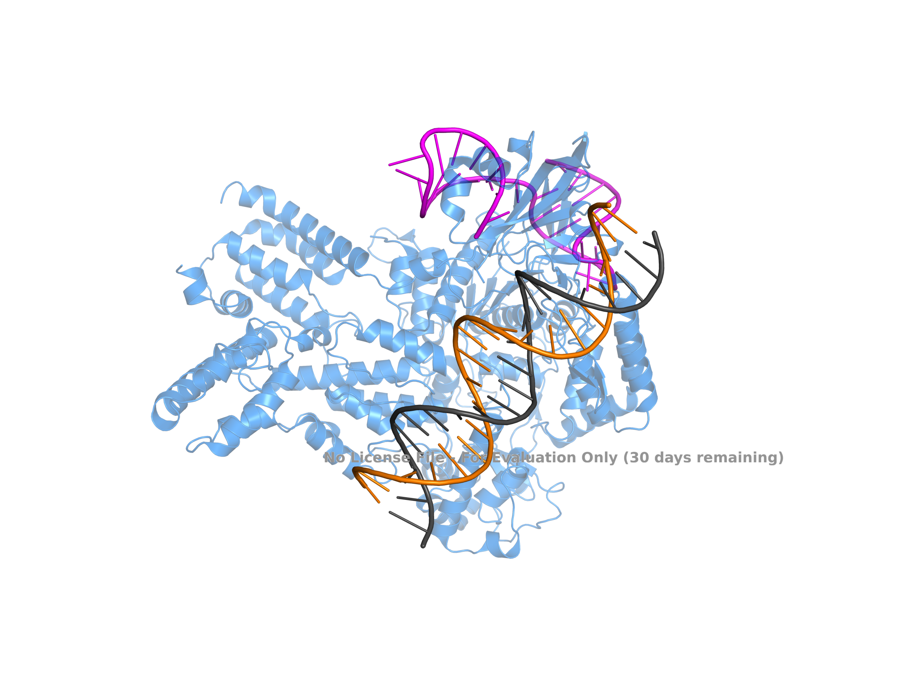
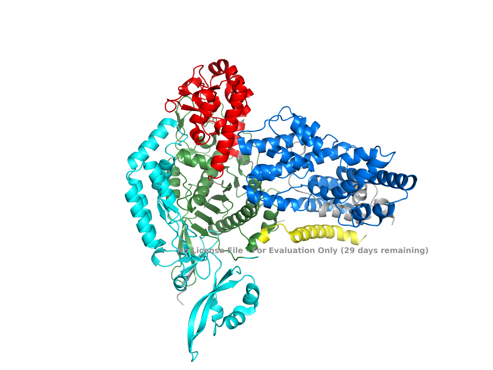

# In-silico Characterisation of SpCas9 Nuclease
## A Bioinformatics Approach to Protein Sequence, Domain and Structural Analysis

**Project type:** Independent computational bioinformatics project

## Abstract

SpCas9 is an RNA-guided DNA endonuclease associated with the CRISPR-Cas9 genome-editing system. This project presents an in-silico characterisation of *Streptococcus pyogenes* Cas9 (SpCas9) using protein sequence analysis, physicochemical property prediction, conserved domain annotation, sequence similarity searching and structural bioinformatics.

The reference protein sequence (UniProt Q99ZW2; 1,368 amino acids) was analysed using Biopython and Python. Amino acid composition and physicochemical properties were calculated. InterProScan and NCBI CD-Search were used to investigate domain architecture. BLASTp and pairwise alignment were performed to assess sequence similarity. The three-dimensional SpCas9 complex (PDB 7S3H) was visualised using PyMOL, and its modelled protein sequence was compared with the UniProt reference.

The analyses provide a computational overview of SpCas9 sequence characteristics, domain organisation and structural representation. The work is entirely computational and does not include experimental protein expression, purification or activity validation.

## 1. Introduction

CRISPR-Cas systems are adaptive immune systems found in bacteria and archaea. The CRISPR-Cas9 system has become an important genome-editing technology because it uses a guide RNA to direct the Cas9 nuclease towards a complementary DNA target.

SpCas9 contains multiple functional regions, including the recognition lobe (REC), HNH nuclease domain, RuvC nuclease domain and PAM-interacting region. These regions contribute to guide RNA interaction, target recognition and DNA cleavage.

Understanding the sequence composition, physicochemical properties, domain organisation and three-dimensional structure of SpCas9 provides a useful foundation for protein bioinformatics and structural analysis.

## 2. Aim

To computationally characterise the SpCas9 protein through sequence analysis, physicochemical property prediction, functional domain investigation, sequence similarity analysis and three-dimensional structural visualisation.

## 3. Objectives

1. Retrieve and validate the SpCas9 reference protein sequence.
2. Determine amino acid composition and percentage distribution.
3. Calculate sequence-derived physicochemical properties.
4. Identify and compare conserved functional domains.
5. Perform BLASTp sequence similarity analysis.
6. Conduct pairwise protein sequence alignment.
7. Visualise the SpCas9 protein–RNA–DNA complex.
8. Compare the modelled structural sequence with the reference sequence.
9. Interpret the computational results and their limitations.

## 4. Materials and Methods

### 4.1 Reference Protein Sequence

The reference SpCas9 protein sequence was retrieved from UniProt.

- Accession: Q99ZW2
- Organism: *Streptococcus pyogenes*
- Sequence length: 1,368 amino acids
- Input file: `data/spcas9_Q99ZW2.fasta`

Biopython's SeqIO module was used for FASTA parsing and sequence validation.

### 4.2 Amino Acid Composition

The frequency of each of the 20 standard amino acids was calculated using Python's Counter function.

The percentage composition was calculated as:

Percentage composition = (Amino acid count / Total amino acid count) × 100

The results were organised using Pandas and visualised using Matplotlib.

### 4.3 Physicochemical Properties

Biopython's ProteinAnalysis module was used to calculate:

- Molecular weight
- Theoretical isoelectric point
- Instability index
- GRAVY (grand average of hydropathicity)

The aliphatic index was calculated separately using amino acid composition-based calculations.

### 4.4 Conserved Domain Analysis

The protein sequence was submitted to InterProScan and NCBI CD-Search to investigate conserved domains and functional regions.

The resulting annotations were compared to distinguish broad protein architectural regions from individual database profile matches.

A domain architecture figure and a database comparison figure were generated using Python and Matplotlib.

### 4.5 BLASTp Analysis

BLASTp was used to identify protein sequences similar to the reference SpCas9 sequence.

The retrieved results were processed and filtered for analysis. Sequence identity and query coverage were examined, and visualisations were generated.

### 4.6 Pairwise Sequence Alignment

A global pairwise alignment was performed between UniProt Q99ZW2 and WP_011285506.1 using Biopython PairwiseAligner.

Parameters:
- Substitution matrix: BLOSUM62
- Gap opening penalty: -10
- Gap extension penalty: -0.5

Sequence identity, mismatches and gaps were recorded.

### 4.7 Three-Dimensional Structure Analysis

The SpCas9 structure was retrieved from the RCSB Protein Data Bank.

- PDB ID: 7S3H
- Experimental method: Cryo-electron microscopy
- Resolution: 2.5 Å

The structure was visualised using PyMOL. Protein, RNA and DNA chains were displayed separately, and selected protein domains were assigned different colours.

### 4.8 PDB and UniProt Sequence Comparison

The modelled SpCas9 protein sequence from chain P was extracted from the PDB structure.

The extracted sequence was aligned against the UniProt Q99ZW2 reference sequence to identify:
- Modelled residues
- Residues absent from the structural coordinates
- Amino acid substitutions

## 5. Results

### 5.1 Protein Sequence Validation

The reference FASTA sequence was successfully parsed and validated.

**Observed sequence length: 1,368 amino acids.**

### 5.2 Amino Acid Composition

All 20 standard amino acids were identified.

Key observations:

| Amino acid | Count | Percentage |
|---|---:|---:|
| Lysine (K) | 150 | 10.96% |
| Leucine (L) | 148 | 10.82% |
| Cysteine (C) | 2 | 0.15% |

Lysine was the most abundant amino acid, followed closely by leucine. Cysteine was the least abundant.

**Figure 1.** Amino acid composition of *Streptococcus pyogenes* SpCas9 (UniProt Q99ZW2; 1,368 amino acids).

### 5.3 Physicochemical Properties

The calculated physicochemical properties are summarised below.

| Property | Result |
|---|---:|
| Sequence length | 1,368 amino acids |
| Molecular weight | 158,439.38 Da |
| Theoretical pI | 8.98 |
| Instability index | 37.57 |
| Aliphatic index | 89.44 |
| GRAVY | -0.594 |

The predicted molecular weight was approximately 158.44 kDa. The theoretical pI was 8.98.

The instability index was below the conventional threshold of 40, indicating a stable classification under this sequence-based prediction method. The negative GRAVY value indicated an overall hydrophilic tendency.

These values are theoretical sequence-derived estimates and do not establish experimental protein stability or solubility.

### 5.4 Domain Architecture

Domain annotation identified the major architectural and functional regions of SpCas9.

| Region | Approximate sequence positions |
|---|---|
| RuvC-I | 1–62 |
| Arginine-rich motif (ARM) | 56–73 |
| Recognition lobe (REC) | 56–718 |
| Bridge helix | 60–93 |
| RuvC-II | 718–765 |
| HNH | 770–921 |
| HNH functional region | 810–872 |
| RuvC-III | 925–1102 |
| PAM-interacting region | 1099–1368 |

The REC lobe represents a broad architectural annotation. Database-specific profile matches cover narrower intervals. Similarly, the HNH functional region and its Pfam profile match represent different annotation definitions.

The RuvC domain is discontinuous and consists of three sequence segments.

**Figure 2.** SpCas9 domain architecture and functional regions. Boundaries are approximate and derived from sequence-based annotations and literature definitions. ARM overlaps the bridge helix; overlapping regions are displayed on separate tracks.

### 5.5 Comparison of Domain Annotations

InterProScan and NCBI CD-Search results were compared.

The REC and PAM-interacting regions showed corresponding database annotations, although their reported boundaries varied slightly.

InterProScan identified specific HNH and RuvC profile matches. The supplied NCBI CD-Search results did not independently identify specific HNH and RuvC domain hits.

This comparison demonstrates that different domain databases can provide different levels of annotation specificity.

**Figure 3.** Comparison of SpCas9 domain annotations obtained from InterProScan and NCBI CD-Search.

### 5.6 BLASTp Analysis

The filtered BLASTp results contained 51 hits.

| Parameter | Result |
|---|---:|
| Number of filtered hits | 51 |
| Mean sequence identity | 99.874% |
| Mean query coverage | 99.971% |
| Hits with 100% identity | 5 |

The retrieved sequences showed very high similarity to the reference SpCas9 sequence.

These results describe the selected database hits and should not be interpreted as 51 independent evolutionary homologues.

**Supporting outputs:** `results/blastp/` and `docs/blastp_analysis.md`.

### 5.7 Pairwise Sequence Alignment

Global pairwise alignment was performed between Q99ZW2 and WP_011285506.1.

| Parameter | Result |
|---|---:|
| Query length | 1,368 amino acids |
| Reference length | 1,368 amino acids |
| Identical residues | 1,367 |
| Mismatches | 1 |
| Gaps | 0 |
| Sequence identity | 99.927% |

A single substitution, E24D, was identified at position 24.

This represents a conservative substitution between acidic amino acids. Its functional effect was not experimentally investigated.

### 5.8 Three-Dimensional Structural Visualisation

The 7S3H structure was visualised using PyMOL.

The modelled chains included:

| Chain | Component | Modelled residues |
|---|---|---:|
| P | SpCas9 protein | 1,030 |
| R | RNA | 30 |
| N | DNA | 23 |
| T | DNA | 23 |

**Figure 4.** Three-dimensional representation of the SpCas9–RNA–DNA complex. The protein, RNA and DNA chains are distinguished by colour.

The protein was also visualised with different colours assigned to selected domains.

**Figure 5.** Domain-coloured three-dimensional representation of SpCas9 showing the selected REC, HNH, RuvC, PAM-interacting and bridge helix regions.

### 5.9 PDB and UniProt Sequence Comparison

The extracted chain P sequence contained 1,030 modelled residues.

Comparison with the 1,368-amino-acid UniProt reference identified:

- 338 reference residues absent from the structural coordinates.
- One substitution at reference position 1337: T to C.
- The largest missing region was 448–715.

The absent residues represent regions not modelled in the structural coordinates. They should not be interpreted as confirmed biological deletions.

## 6. Discussion

The combined analyses provide a computational overview of SpCas9 at the sequence, domain and structural levels.

The amino acid composition analysis identified lysine and leucine as the most abundant residues. Physicochemical calculations provided estimates of molecular weight, theoretical pI, instability index, aliphatic index and hydropathic character.

Domain annotation demonstrated the organisation of the major SpCas9 regions. Differences between InterProScan, NCBI CD-Search and literature-derived boundaries highlight the importance of understanding annotation methods before interpreting protein architecture.

BLASTp and pairwise alignment showed high sequence similarity between the selected reference and comparison sequences. The single E24D substitution was conservative, although no functional conclusion can be drawn from sequence similarity alone.

Structural visualisation provided a representation of the protein in complex with RNA and DNA. Comparing the modelled structure with the reference sequence identified regions absent from the structural coordinates, illustrating that experimentally determined structural models may not contain coordinates for every residue in the reference sequence.

Overall, the project integrates sequence analysis, database annotation, similarity searching and structural visualisation into a reproducible computational workflow.

## 7. Limitations

1. Physicochemical properties are theoretical predictions rather than experimental measurements.
2. Domain boundaries depend on the annotation resource and structural definition.
3. BLASTp results depend on database contents, search settings and filtering criteria.
4. Missing residues in the structural model do not necessarily represent biological deletions.
5. PyMOL visualisation does not establish protein activity or biochemical function.
6. No protein expression, purification, enzyme activity assays, molecular dynamics simulations or experimental validation were performed.

## 8. Conclusion

This project demonstrates an integrated in-silico workflow for the characterisation of SpCas9 using protein sequence analysis, physicochemical property prediction, domain annotation, BLASTp, pairwise sequence alignment and three-dimensional structural visualisation.

The findings provide practical experience in Python-based bioinformatics, biological database interpretation, protein sequence analysis and structural bioinformatics.

The project serves as an independent computational portfolio demonstrating foundational skills relevant to protein science, genomics and bioinformatics research.

## 9. References

1. UniProt Consortium. UniProt entry Q99ZW2: *Streptococcus pyogenes* Cas9. https://www.uniprot.org/uniprotkb/Q99ZW2/entry
2. RCSB Protein Data Bank. PDB entry 7S3H. https://www.rcsb.org/structure/7S3H
3. Nishimasu H. et al. (2014). Crystal Structure of Cas9 in Complex with Guide RNA and Target DNA. *Cell*, 156(5), 935–949. https://doi.org/10.1016/j.cell.2014.02.001
4. National Center for Biotechnology Information. BLAST. https://blast.ncbi.nlm.nih.gov/
5. European Bioinformatics Institute. InterPro. https://www.ebi.ac.uk/interpro/
6. National Center for Biotechnology Information. Conserved Domain Database. https://www.ncbi.nlm.nih.gov/Structure/cdd/
7. Biopython documentation. https://biopython.org/
8. Schrödinger. PyMOL Molecular Graphics System. https://pymol.org/
